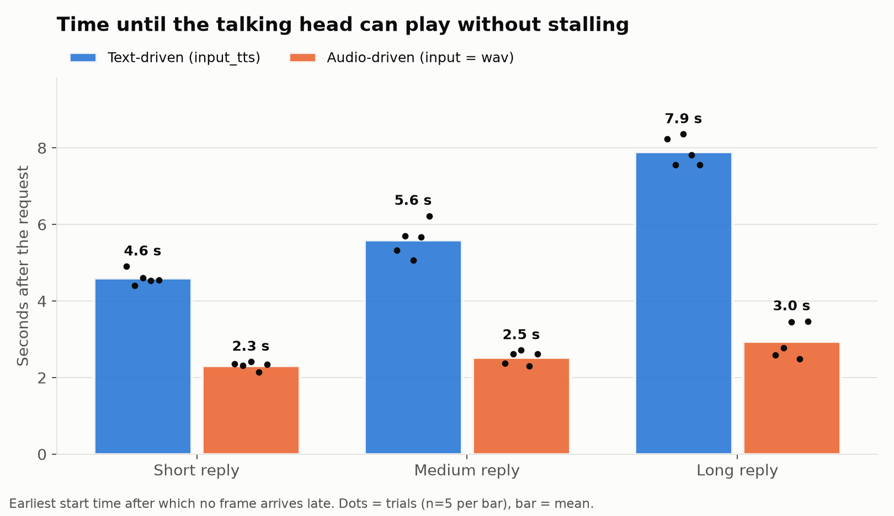
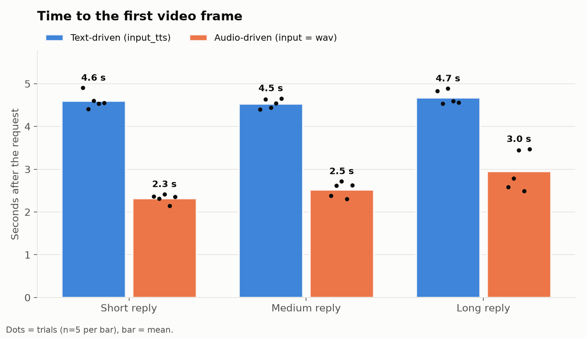
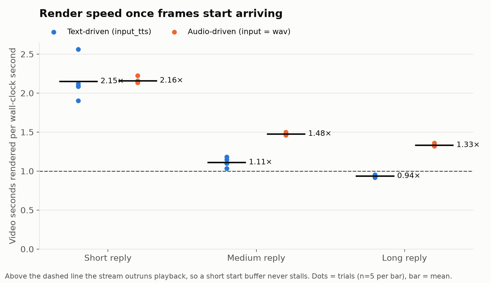
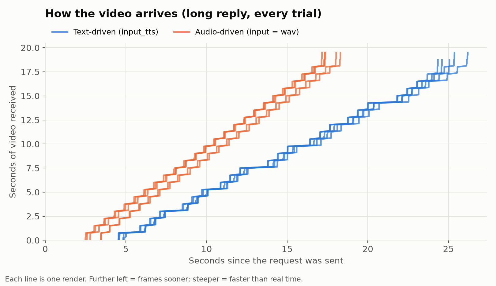
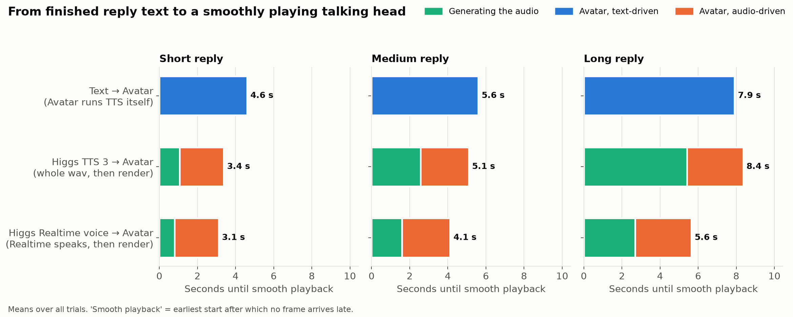

# Higgs Avatar: text-driven vs audio-driven renders

**Question.** A talking-head reply should start moving as soon as possible after the reply is
written. Higgs Avatar (`POST /v1/videos/stream`) accepts the speech in two ways:

- **Text-driven**: `input_tts` with the reply text; Avatar runs Higgs TTS 3 itself.
- **Audio-driven**: `input` with a finished WAV of the reply.

Which one gets to smooth playback sooner, and does it matter where the audio comes from
(Higgs TTS 3 or Higgs Realtime speaking the reply)?

**Answer.** Give Avatar finished audio. In 15 rounds (3 reply lengths × 5), audio-driven renders
reached smooth playback **2.3–5.0 s sooner** (50–63%) than text-driven ones, and the gap grows
with reply length:

- **Frames start ~2 s sooner** (2.3–3.0 s vs 4.5–4.7 s). With text, Avatar has to run TTS
  before it can render.
- **Frames then come faster than real time** (1.33–2.16×). Text-driven renders of medium and
  long replies run at only 0.94–1.11×, so a player has to wait longer before it can start without
  stalling. For long replies, text-driven needs 7.9 s, audio-driven 3.0 s.
- **Where the audio comes from matters.** Higgs Realtime speaks a whole reply 4–7× faster than
  real time, about 2× faster than Higgs TTS 3 makes the same WAV. From finished reply text to
  smooth playback: Realtime → Avatar **3.1 / 4.1 / 5.6 s**, against 4.6 / 5.6 / 7.9 s for
  text → Avatar (short / medium / long reply).



## What is measured

Every condition uses the same reference image, the same voice, the same output size (640×640) and
the same reply text. Three reply lengths (about 3 s, 9 s and 18 s of speech). In each round the
four conditions run in random order, so drifts in server load affect all of them equally.

| Condition | Call | Measures |
|---|---|---|
| `avatar_text` | `/v1/videos/stream`, `input_tts` | video timing |
| `avatar_audio` | `/v1/videos/stream`, `input` = WAV (made once per length with TTS 3) | video timing |
| `tts_full` | `/v1/audio/speech`, whole WAV | time to generate the audio |
| `realtime` | `wss /v1/realtime`, `higgs-realtime-1.5-preview`, audio output | time to first audio and to the whole reply |

For each render the fMP4 stream is recorded with the arrival time of every network chunk, then
each video frame (by its pts, from `ffprobe`) is mapped to the moment its bytes had arrived:

- **First frame**: when the first frame's bytes arrived.
- **Smooth start**: the earliest moment playback could begin and never stall,
  `max over frames (arrival time − frame pts)`. This is what a player has to wait for.
- **Render speed**: seconds of video produced per wall-clock second once frames flow.
  Above 1× the stream outruns playback, so a short start buffer is safe.

Rate-limit retries (HTTP 429) are not counted: each attempt is timed on its own.

## Run it

From the `backend` folder (uses its virtualenv; needs `ffprobe` on PATH):

```bash
.venv/Scripts/python.exe -m pip install -r model_speed_test/requirements.txt
.venv/Scripts/python.exe model_speed_test/bench.py --image path/to/portrait.jpg --trials 5
.venv/Scripts/python.exe model_speed_test/analyze.py
```

The API key comes from `BOSON_API_KEY` or the repo's `.env`. Raw results are appended to
`results/raw.jsonl`; `analyze.py` writes `results/summary.csv`, `results/report.md` and `plots/`.
A full run (3 lengths × 5 rounds) takes about 15 minutes and renders about 5 minutes of video.

## Results

Run on 2026-10-24: 5 rounds × 3 reply lengths, 60 calls, no failures or rate limits.
Full numbers: [`results/report.md`](results/report.md) and [`results/summary.csv`](results/summary.csv);
every call: `results/raw.jsonl`.

| Reply (speech) | Smooth start, text-driven | Smooth start, audio-driven | Saved | Render speed, text / audio |
|---|---|---|---|---|
| Short (3.8 s) | 4.60 ± 0.18 s | 2.32 ± 0.10 s | 2.3 s (50%) | 2.15× / 2.16× |
| Medium (9.8 s) | 5.60 ± 0.44 s | 2.53 ± 0.18 s | 3.1 s (55%) | 1.11× / 1.48× |
| Long (19.6 s) | 7.91 ± 0.38 s | 2.96 ± 0.47 s | 5.0 s (63%) | 0.94× / 1.33× |





The arrival curves show both effects at once: audio-driven renders start earlier and climb more
steeply. Text-driven renders of a long reply fall behind real time.



End to end, from finished reply text to smooth playback, the audio has to be made first. Higgs TTS 3
takes 1.1 / 2.6 / 5.4 s for the whole WAV, so for a long reply TTS 3 → Avatar is no faster than text →
Avatar. Higgs Realtime produces the same speech in 0.8 / 1.6 / 2.7 s (first audio after ~0.4 s), which
makes Realtime → Avatar the fastest path at every length.



### Caveats

- One reference image, one voice (`default`), one size (640×640), one network location. The
  pattern held across all 15 rounds, but absolute times depend on server load.
- Higgs Realtime was asked to read each text verbatim. It sometimes stopped early or shortened
  the text (complete reads: 4/5 short, 4/5 medium, 2/5 long). Only complete reads count for its
  timing. In a real conversation Realtime writes its own reply, so this is not a problem there.
- The audio-driven render uses a TTS 3 WAV for every audio source. The end-to-end chart adds
  each source's generation time to that render time, assuming Avatar timing depends on the audio
  length and not on which model made it.
